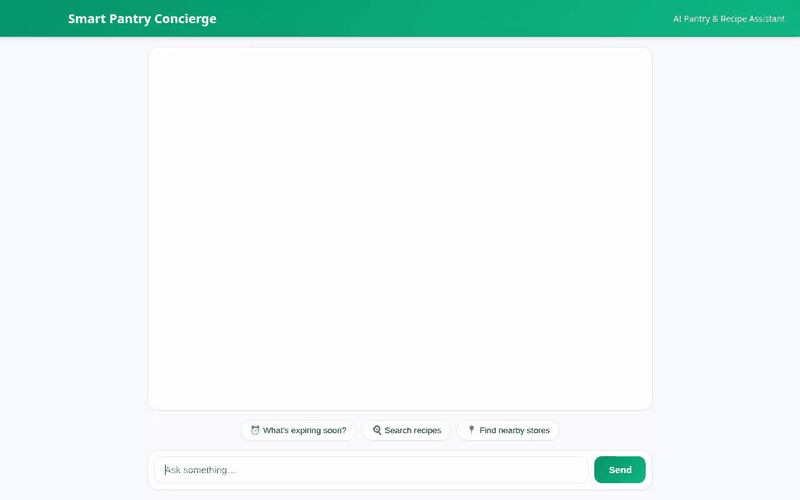

# Smart Pantry Concierge 🍳 Smart Household AI Assistant

An intelligent, AI-powered pantry management and culinary concierge built with **Google Agent Development Kit (ADK)**, **Vertex AI**, and **Google Cloud Services**.



---

## 🌟 Overview

The **Smart Pantry Concierge** helps users manage household pantry inventory, prevent food waste by tracking expiring items, discover personalized recipes based on available ingredients, enforce strict allergy and dietary restrictions across sessions, locate nearby grocery stores, and generate rich dish media (images and videos).

---

## 🚀 Key Features & Implemented Tools

All capabilities listed below are fully implemented and wired in code:

* **📦 Firestore Pantry Inventory Management**
  * `get_pantry_items`: Retrieves current pantry stock from Google Cloud Firestore.
  * `add_pantry_item`: Adds new items with expiration dates and quantities.
  * `check_expiring_items`: Queries Firestore for items expiring within a configurable threshold to prevent waste.

* **🧠 Cross-Session Memory & Allergy Safety**
  * Integrated with **Vertex AI Memory Bank Service** (`LoadMemoryTool`, `PreloadMemoryTool`).
  * Automatically records user food allergies (e.g., peanuts, tree nuts, shellfish, gluten, dairy) and dietary preferences across sessions.
  * Enforces strict safety rules to filter out recipes containing remembered allergens.

* **🍳 Recipe Discovery & Ingredient Matching**
  * `search_recipes`: Recommends curated recipes matching available pantry items while respecting dietary restrictions.

* **📍 Nearby Store Locator & Geocoding**
  * `geocode_address`: Converts addresses into geographic coordinates using OpenStreetMap Nominatim.
  * `find_nearby_places`: Locates nearby grocery stores and supermarkets using Overpass API.

* **📸 AI Food Image Generation**
  * `generate_recipe_image`: Generates dish photos using Google's **Imagen 3** (`imagen-3.0-generate-002`). Saves artifacts and uploads bytes to a public **Google Cloud Storage** bucket.

* **🎥 Culinary Video Generation**
  * `generate_recipe_video`: Generates short culinary preparation videos using Google's **Omni model** (`gemini-omni-flash-preview`) in the global region. Uploads video bytes directly to Cloud Storage.

* **🎨 Interactive A2UI Component Payload**
  * Supports **A2UI Protocol (v0.8 Basic Catalog)** to render rich UI cards (Cards, Columns, Rows, Text, Dividers, Images, Icons) dynamically inside the chat stream.

---

## 🛠️ Technology Stack & Architecture

* **Core Agent Runtime**: Google Agent Development Kit (ADK), Gemini Flash (`gemini-flash-latest`)
* **Stateful Memory**: Vertex AI Memory Bank Service
* **Database**: Google Cloud Firestore (`qwiklabs-gcp-01-ffa5389289dd`)
* **Storage**: Google Cloud Storage (`smart-pantry-assets-ffa538`)
* **Generative Media**: Google Imagen 3 (`imagen-3.0-generate-002`), Google Omni (`gemini-omni-flash-preview`)
* **Frontend**: FastAPI, HTML5/CSS3 (Emerald design system), JavaScript

---

## 💻 Local Setup & Execution

### Prerequisites
* Python 3.10+
* Google Cloud CLI (`gcloud`) authenticated with access to Firestore, Vertex AI, and Cloud Storage.

### Installation

1. Clone the repository and install python dependencies:
   ```bash
   cd demo-agent
   pip install -r requirements.txt
   ```

2. Set required environment variables:
   ```bash
   export AGENT_ENGINE_RESOURCE_NAME="projects/<project-id>/locations/<region>/reasoningEngines/<engine-id>"
   export AGENT_DIRECTORY="app"
   ```

3. Run the local application server:
   ```bash
   python main.py
   ```
   The application web interface will start locally on port 8080.
